# 🛠️ git_accessories

A collection of lightweight Python utilities for fetching and analyzing your GitHub activity.

## 📦 Current Tools

### `git_card.py` — Commit Counter

Fetches all your public GitHub repositories and counts your **total commits over the last 12 months** across all of them.

**Example output:**
```
Checking portfolio...
Checking git_accessories...
Checking hospital-management...

🔥 Total commits in last 12 months: 342
```

### `git_langs.py` — Language Breakdown

Fetches all your public GitHub repositories (forks skipped by default), sums the **bytes of code per language** across them, and prints a sorted bar chart of your top languages.

**Example output:**
```
Checking portfolio...
Checking git_accessories...
Checking hospital-management...

📊 Language breakdown across 12 repos:

Python       ████████████░░░░░░░░░░░░░  48.2%
JavaScript   █████░░░░░░░░░░░░░░░░░░░░  21.7%
HTML         ███░░░░░░░░░░░░░░░░░░░░░░  13.1%
CSS          ██░░░░░░░░░░░░░░░░░░░░░░░   9.4%
Other        ██░░░░░░░░░░░░░░░░░░░░░░░   7.6%
```

**Flags:**

| Flag | Description |
|------|-------------|
| `--top N` | Number of languages to show (default: 8). The rest are grouped into "Other". |
| `--include-forks` | Include forked repositories (skipped by default). |

### `git_hours.py` — Coding Hours Heatmap

Fetches every commit you authored in your public repositories over the last 12 months, converts the timestamps to **your timezone**, and prints a **weekday × hour heatmap** of when you code, plus a short summary.

> This tool makes one request per 100 commits per repo — a `GITHUB_TOKEN` is strongly recommended.

**Example output:**
```
Checking portfolio...
Checking git_accessories...

🕒 Commit heatmap (last 12 months, Asia/Kathmandu)

      00 03 06 09 12 15 18 21
Mon   ░▓░░  ░    ░░░ ░░▓▒█▓▓▒▒
Tue   ▓▒░░░░       ▒░▒░▒██▓▒░▒
Wed    ░     ░ ░░░░▒░░▓░░▒▒░▒▓
Thu   ░█░        ░░░░░░▒▒░▒▓▓░
Fri   ▒░░         ░ ░▒█▒▓█▒▓▓▒
Sat   ░░░░░      ░░▒░▒▒▓▓▒▓▒░░
Sun   ▒▒░         ░▓▓▒▒▓▓░▓░░░

📈 342 commits analyzed
⏰ Peak hour: 20:00–21:00 (33 commits)
📅 Busiest day: Monday (56 commits)
🦉 Night owl score: 28% of commits between 22:00 and 04:00
```

Each column is one hour; shades (` ░▒▓█`) are scaled to your busiest cell.

**Flags:**

| Flag | Description |
|------|-------------|
| `--tz NAME` | IANA timezone, e.g. `Asia/Kathmandu` (default: system timezone). On Windows, run `pip install tzdata` if valid names aren't recognized. |
| `--months N` | Lookback window in months (default: 12). |
| `--include-forks` | Include forked repositories (skipped by default). |

### `git_streak.py` — Contribution Streak Tracker

Fetches your GitHub **contribution calendar** via the GraphQL API and shows your **current streak**, **longest streak**, total contributions, active days, best day, and a strip of the last 30 days.

> 🔑 **This tool requires a token.** GitHub's GraphQL API does not accept unauthenticated requests. A classic token with the `read:user` scope is enough.

If you haven't contributed yet today, your streak isn't broken: it is counted up to yesterday and marked "(today not counted yet)".

**Example output:**
```
🔥 Contribution streaks for samriddhakunwar

Current streak:   12 days  (Oct 13 → Oct 24)
Longest streak:   27 days  (Mar 02 → Mar 28, 2026)
Total (1 year):   1,284 contributions
Active days:      231 / 365  (63%)
Best day:         Jun 14, 2026 — 41 contributions

Last 30 days:
░▒▓█▓▒ ░▒▓▓█▒░░▒▓▓█▓▒░▒▓█▓▒░
```

Shades (` ░▒▓█`) in the 30-day strip are scaled to your busiest day in that window.

**Flags:**

| Flag | Description |
|------|-------------|
| `--years N` | Years to look back (default: 1). Makes one GraphQL query per year. |
| `--tz NAME` | IANA timezone used to decide "today", e.g. `Asia/Kathmandu` (default: system timezone). |

### `git_audit.py` — Repo Health Audit

Checks each of your public repositories for common gaps and gives it a **health score out of 100**. Forks and archived repos are skipped by default. **Read-only:** it never modifies a repo.

| Check | Penalty |
|-------|---------|
| Empty repo (size 0) | −50 |
| No README | −25 |
| No description | −20 |
| No license | −15 |
| Stale (not pushed in 6+ months) | −15 |
| No topics | −10 |
| No homepage (only for website-like repos: HTML/CSS/JS/TS, or "portfolio"/"site"/"web" in the name) | −10 |

The weights live in the `WEIGHTS` dict at the top of `git_audit.py`, so you can tweak them. If the README check fails for a reason other than "not found", it shows as "README unknown" and costs no points.

**Example output:**
```
Checking old-calculator...
Checking hospital-management...
Checking portfolio...
Checking git_accessories...

🩺 Repo health audit for samriddhakunwar (4 repos)

Score  Repo                   Issues
 25    old-calculator         stale (2y), no README, no description, no license
 75    hospital-management    no license, no topics
 80    portfolio              no topics, no homepage
100    git_accessories        ✓ all good

📋 Summary
   Average health:   70 / 100
   Missing README:   1 repo
   Missing license:  2 repos
   Stale (>6 mo):    1 repo

💡 Quick win: add a license to 2 repos for +15 each
```

**Flags:**

| Flag | Description |
|------|-------------|
| `--stale-months N` | Flag repos not pushed in N months (default: 6). |
| `--min-score N` | Only show repos scoring below N. |
| `--json` | Print full results as JSON instead of the table (progress lines go to stderr, so stdout stays pipeable). |
| `--include-forks` | Include forked repositories (skipped by default). |
| `--include-archived` | Include archived repositories (skipped by default). |

### `git_banner.py` — Profile Stats SVG Card

Generates a self-contained **SVG stats card** for your profile README: total stars, total forks, public repos (non-fork), followers, most starred repo, and a stacked bar of your **top 5 languages**. With a `GITHUB_TOKEN`, it also shows **contributions in the last year** and your **current streak**. Without a token, those two are left off and a note is printed.

The card uses only inline shapes and a system font stack (no external fonts, scripts or images, which GitHub strips), plus a subtle CSS fade-in. Any stat that fails to fetch is left off the card instead of crashing the run.

**Example output:**
```
Checking portfolio...
Checking git_accessories...
Checking hospital-management...

✅ Saved banner.svg (dark theme)

Add this to your profile README:

```

**Embed it:**
```markdown

```

**Flags:**

| Flag | Description |
|------|-------------|
| `--output PATH` | Output file (default: `banner.svg`). |
| `--theme dark\|light` | Color theme (default: `dark`, matching GitHub dark). Colors live in the `THEMES` dict at the top of the file. |
| `--no-animation` | Disable the fade-in animation. |

**Auto-update with GitHub Actions:** `.github/workflows/update-banner.yml` regenerates `banner.svg` daily (or on demand from the Actions tab via *Run workflow*) and commits it only if it changed. It uses the built-in `GITHUB_TOKEN` with `contents: write`, so no setup is needed for the basic card. For `./banner.svg` to resolve in your profile README, the script and workflow must live in your profile repo (`<username>/<username>`). Otherwise, embed the file's raw URL.

> 🔑 **Contributions and streak in Actions:** the built-in Actions token can't read your GraphQL contribution calendar. To include them, create a personal access token (classic, `read:user` scope) and add it as a repository secret named **`GH_PAT`** (repo → Settings → Secrets and variables → Actions → New repository secret). The workflow automatically uses `GH_PAT` as `GITHUB_TOKEN` when it exists.

---

## 🚀 Getting Started

### 1. Clone the repo

```bash
git clone https://github.com/samriddhakunwar/git_accessories.git
cd git_accessories
```

### 2. Install dependencies

```bash
pip install requests python-dotenv
```

### 3. Set up your environment

Create a `.env` file in the project root:

```env
GITHUB_USERNAME="your_github_username"
GITHUB_TOKEN="ghp_your_personal_access_token"
```

> **How to get a token:** GitHub → Settings → Developer settings → Personal access tokens → Generate new token (classic) → check `repo` scope (`git_streak.py` additionally needs `read:user`).
>
> The token is optional but **strongly recommended** — without it, GitHub's API rate limit is only 60 requests/hour, which won't be enough for users with many repositories.
>
> **`git_streak.py` requires the token** (GitHub's GraphQL API rejects unauthenticated requests) and needs the `read:user` scope.

### 4. Run

```bash
python git_card.py
python git_langs.py                    # or: --top 5 --include-forks
python git_hours.py                    # or: --tz Asia/Kathmandu --months 6
python git_streak.py                   # or: --years 3 --tz Asia/Kathmandu (requires token)
python git_audit.py                    # or: --min-score 80, --json > audit.json
python git_banner.py                   # or: --theme light --output card.svg --no-animation
```

---

## 🔒 Security

- **Never commit your `.env` file.** It is already listed in `.gitignore`.
- Do not hardcode tokens directly in source files — always use environment variables.

---

## 📁 Project Structure

```
git_accessories/
├── git_card.py      # Counts total commits in the last 12 months
├── git_langs.py     # Language breakdown across your repos
├── git_hours.py     # Weekday x hour commit heatmap
├── git_streak.py    # Current/longest contribution streaks
├── git_audit.py     # Repo health scores and quick wins
├── git_banner.py    # Profile stats SVG card generator
├── test_git_banner.py  # Layout self-check for git_banner.py (fake data)
├── banner.svg       # Generated stats card (updated by the workflow)
├── .github/
│   └── workflows/
│       └── update-banner.yml  # Daily banner.svg regeneration
├── .env             # Local secrets (gitignored)
├── .gitignore
└── README.md
```

---

## 🤝 Contributing

Pull requests are welcome! If you have ideas for more GitHub utility scripts to add to this collection, feel free to open an issue or PR.

---

## 📄 License

MIT
